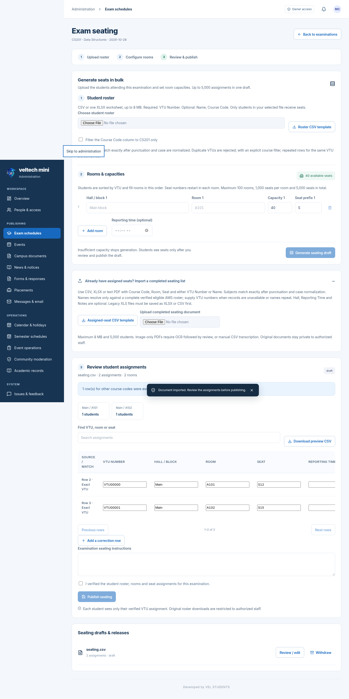

# veltech-ams-mini 2.3.1

[Full updated project ZIP](veltech-ams-mini-v2.3.1.zip) · [Setup and deployment guide](setup-guide.md) · [Watch preview](preview.mp4) · [Verification](verification.md)

The ZIP includes all combined source modules, Windows Docker scripts and the signed Android deployment release folder. Preserve your current data, private configuration and signing key when upgrading.

## Password-only app sign-in

Returning verified AMS-linked students can enter the workspace with their VTU username/mailbox and last verified application password, without starting another AMS CAPTCHA. Legacy accounts establish the verifier with one successful official verification or verified email recovery. A new university data session still needs official verification whenever AMS requires it. The app does not fake fresh data or bypass that check.

## APK from your domain

After deploying the included public `android-release` directory using the guide, the install URL is:

**https://app.veltech-mini-ams.me/api/campus/app-release/latest.apk**

Settings checks and downloads the checksum-pinned APK through that same domain. The stable link serves the local verified APK directly. There is no standalone APK hosted on this delivery branch. The project archive is for the owner to deploy; it is not the student install URL. Production deployment remains manual.

Android2.3.1/build20301 uses the same local package/signing identity as the previous prepared APK. The inaccessible Actions artifact's certificate could not be checked. Android owns install/Play Protect prompts; domain association and a real phone still need rollout acceptance.

## Updated mobile experience

- Transparent blue/teal/silver3D hybrid mark with the college shield element. No outer circle/stamp. Sides rise, cap lands, then centre appears; reduced motion is supported.
- Local Inter typography and optional phone page swipes.
- Live current/next class understands actual AMS AM/PM values, with relevant exam/own-seat reminders.
- Follow, likes and comments stay inline. Horizontal connection suggestions and stale-read/privacy fixes preserve the feed.
- Optional update notices honor Later; safe asset refresh preserves sessions/downloads.
- CSV/XLSX/text-PDF seating import, source-row review, exact course/VTU or unique verified-name matching and private student seat views. Legacy XLS needs conversion; scanned PDFs need reviewed OCR/CSV.

Fresh checks: **960 automated tests and24 browser checks passed**, plus production PWA build and actual APK compile/signature/identity/alignment/checksum verification. Browser examples use fictional preverified accounts. No new real AMS login, production deployment, physical phone test or campus-scale load test was performed.

Developed by VEL STUDENTS.
