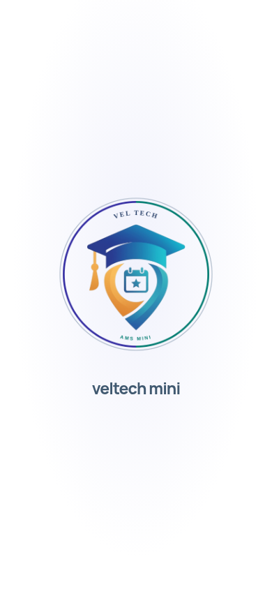

# veltech-ams-mini — logo animation update

**Version remains2.2.0.**

[Full updated project ZIP](veltech-ams-mini-v2.2.0.zip) · [Updated signed APK](veltech-ams-mini-2.2.0.apk) · [Setup guide](setup-guide.md) · [Watch animation](preview.mp4) · [Verification](verification.md)

Your original project cap, curved sides, calendar and star are retained. The new college-style circular frame adds indigo, emerald and silver accents without replacing the original mark.

## Animation

The side curves and frame rise slowly; the cap falls from above the screen and settles; the original calendar/centre and seal details appear last. The same sequence is used at startup and after verified sign-in before student identity/Home. Reduced motion and the opening-animation setting are respected. Navigation and same-tab refresh do not replay the opening screen.

## Complete project and Android update

The ZIP contains the entire current source and verified public Android release folder. All application features remain included. The APK preserves the signing identity/package and displayed version2.2.0; internal Android build20201 updates20200. Deploy the website to update the animation served at https://app.veltech-mini-ams.me. The same public Asset Links certificate remains valid; domain verification still needs your deployment acceptance checks. Private signing material is absent.

Fresh checks:292 frontend tests,16 Android helper tests,1 download-route test and6 real browser animation checks passed. Native APK compile, signature, identity/alignment and independent publication checks passed. Physical phone installation was not performed. No production/AWS/real AMS data was changed.

Developed by VEL STUDENTS.
