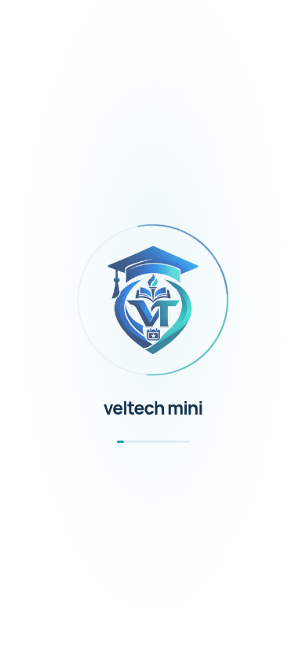
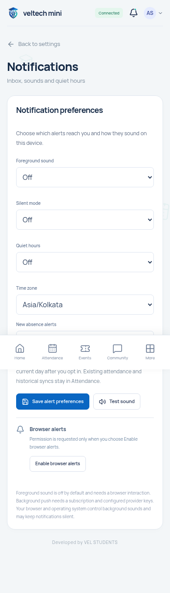
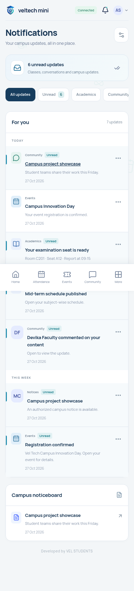
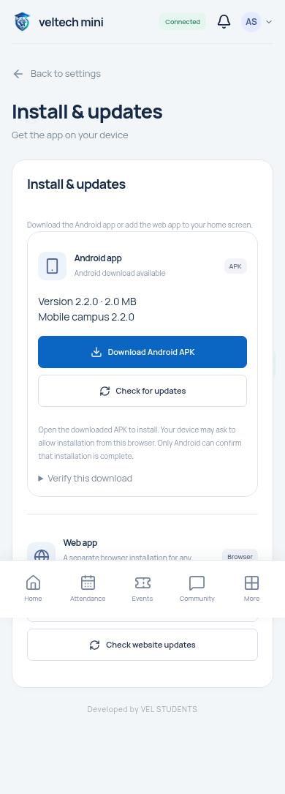

# veltech-ams-mini 2.2.0

[Full project ZIP + public Android release](veltech-ams-mini-v2.2.0.zip) · [Signed Android APK](veltech-ams-mini-2.2.0.apk) · [Setup and upgrade](setup-guide.md) · [AWS/Cloudflare](aws-cloudflare-guide.md) · [Recorded preview](preview.mp4) · [Verification](verification.md)

This release targets https://app.veltech-mini-ams.me. Deploy the web update first: the signed APK opens that live site and otherwise displays the previous hosted UI. The full ZIP contains clean source plus a separate android-release folder ready to publish in the persistent server media volume. Android signing secrets are absent.

## Mobile login and opening animation

New combined campus/student-project emblem, brief accessible launch animation, clean mobile login and locally bundled Manrope font. Password recovery uses a separate view.

## One live Home reminder hub

Current/next class, exams, the student's own seat and staff publications appear together. Existing 24-hour announcements / 72-hour exam urgency remain. Saved sessions, offline records and background updates are retained.

## Settings and notifications

Mobile settings opens categories in separate views. Inbox actions update individual rows; seating messages open Examinations directly. The existing desktop navigation and other project features remain.

## APK-first installation

The primary action downloads the real signed APK and checks its SHA-256. PWA installation is a separate secondary option. Android asks the user to confirm installation; downloading a file is not reported as an installed app.

APK: version2.2.0/code20200, package in.velstudents.veltechams, Android7+,2,058,286bytes. Signature v2/v3, certificate, release identity and16KiB alignment were actually verified. [Checksum](veltech-ams-mini-2.2.0.apk.sha256) · [Public signing receipt](android-signing-receipt.json) · [Asset Links JSON](assetlinks.json)

Deploy assetlinks.json at the exact public well-known path and follow the narrowly scoped Cloudflare guidance: the build cloud received403/error1010, so public Android association remains pending. Browser controls may remain until verification succeeds. A physical phone installation test was not performed. Preserve the new private signing identity for future updates; retrieve/back it up privately from the build workspace, never this public repository.

## Validation and limits

919 automated tests,19 integrated browser checks,8 additional mobile route checks and9 Docker runtime checks passed. Screens at1440/390/320px were checked with Playwright Chromium because the Browser plugin was unavailable. These are real rendered screens using fictional controlled accounts, not production student data. This page is a visual preview; use Docker/the upgraded AWS deployment for the connected app. A fresh real AMS login, PostgreSQL capacity test and campus-scale load test were not performed.

[Clean source only](veltech-ams-mini-source.zip) · [Built web/PWA package](veltech-ams-mini-web.zip) · [Android build guide](android-guide.md) · [SMTP guide](smtp-guide.md)

Developed by VEL STUDENTS.
