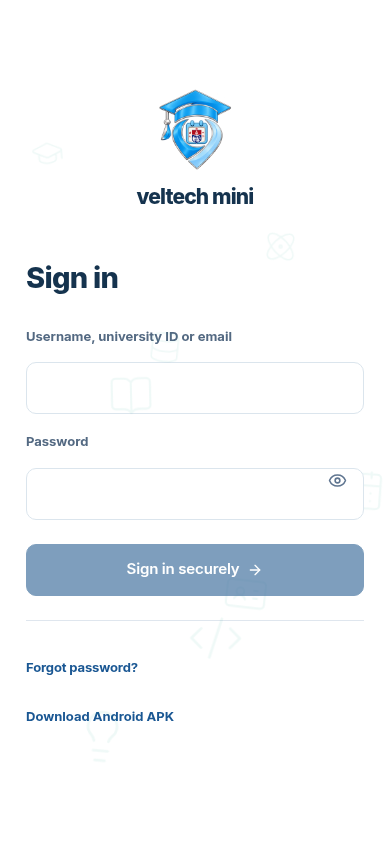

# veltech-ams-mini 2.3.3 · sky-blue logo

[Full updated project ZIP](veltech-ams-mini-v2.3.3.zip) · [Setup and APK deployment guide](setup-guide.md) · [Watch natural animation preview](preview.mp4) · [Verification](verification.md)

The same hybrid logo design now uses the original Attendance project's **sky blue #0EA5E9**, lighter blue tints and satin silver. No outer orange, purple or green. Smooth car-paint finish with restrained reflections; no glow halo or animated brightness flash. The identifying university emblem colours remain. Login/navigation/About, both logo animations, web/PWA icons and the rebuilt Android launcher/splash use the updated artwork.

The ZIP includes the complete combined project and public signed APK deployment files. Deploy the web update and publish the correctly signed APK to your own domain using the guide. Student sharing: **https://app.veltech-mini-ams.me/#/install**. Android code20303. Keep the original signing identity for installed APK updates; prior public domain checks listed another certificate. No production deployment or phone acceptance was performed here.

Fresh verification: **753 automated tests and17 browser checks passed**, production PWA build and genuine signed APK compile/signature/package/alignment/checksum verification. The academic service code is unchanged; its prior tests are documented as historical rather than added to this patch's total. Private secrets/accounts/signing keys are excluded.

Developed by VEL STUDENTS.
