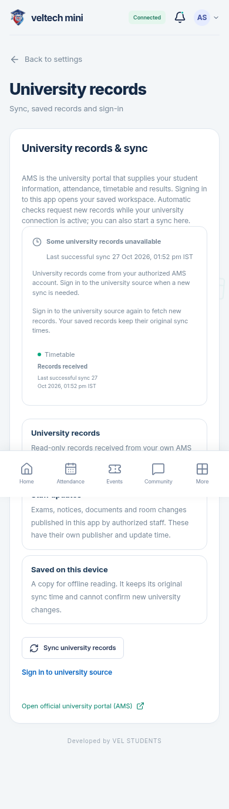

# veltech-ams-mini · updated2.3.3

[Full updated project ZIP](veltech-ams-mini-v2.3.3.zip) · [Setup and deployment guide](setup-guide.md) · [Watch updated animation](preview.mp4) · [Verification](verification.md)

The same hybrid logo design uses college maroon/navy and a light original Attendance-blue accent, with smooth medium reflections. The updated complete mark appears in a short, steady reveal; its centre is not separately flipped or stretched. Login/navigation/About, both introductions, web/PWA icons and Android launcher/splash all use the new colours. Display version remains **2.3.3**, Android build **20304**.

Fresh university-source requests now run at bounded intervals while online, visible, enabled and authenticated to the source. Only committed academic changes update the workspace; campus publications keep their own lightweight checks. Manual/automatic overlap is coalesced, transient failures back off, and expired source sessions reconnect without erasing saved records. Official CAPTCHA is retained when required. Persistent app login does not promise an indefinite upstream session.

Android update metadata can recover after a short transient-failure cooldown, retaining the normal success cooldown and Later24h. The ZIP includes complete combined source and public signed deployment files. Publish the correctly signed APK through **https://app.veltech-mini-ams.me/#/install** using the guide; preserve the original signing key for installed copies. No production deployment or physical-phone acceptance was performed.

Fresh verification: **1,004 automated tests and30 browser checks passed**, production PWA build and genuine signed APK compile/signature/package/alignment/checksum checks. Browser source scenarios used controlled synthetic transport, not new authenticated university rows. Independent review's two material progress races were fixed with RED→GREEN regressions before the full green run. Private secrets/accounts/keys excluded.

Developed by VEL STUDENTS.
