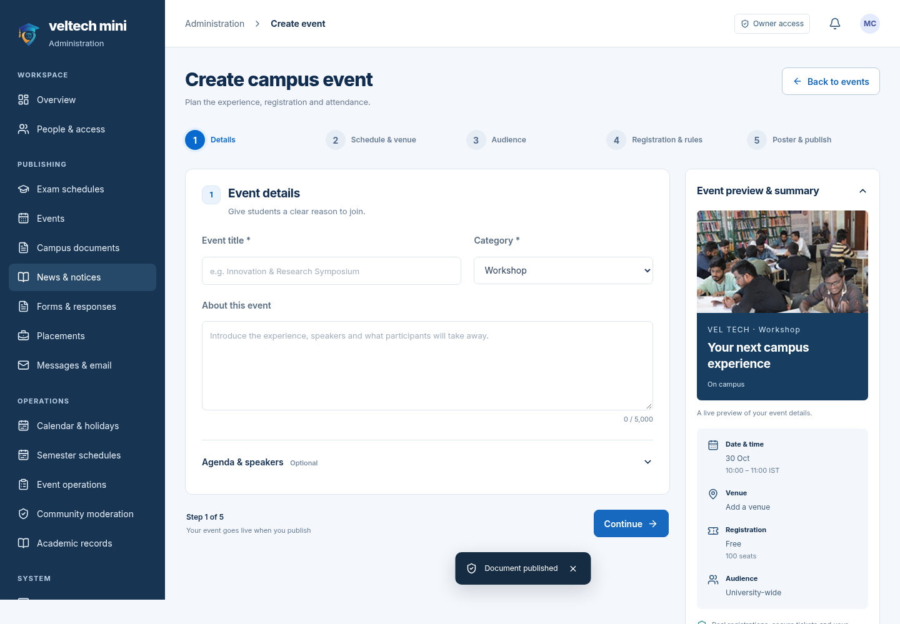
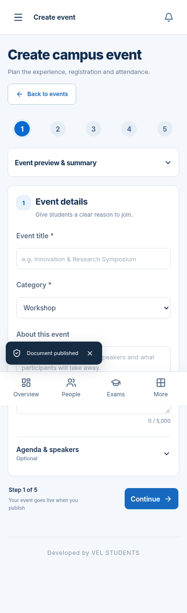
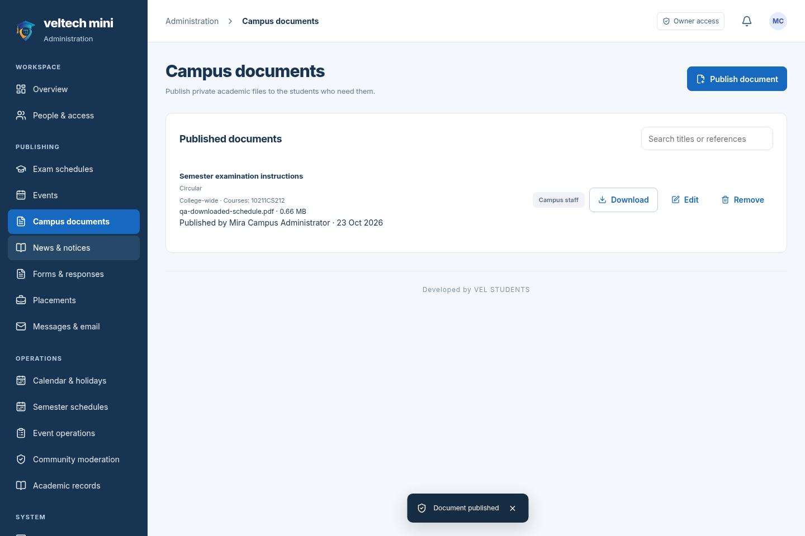
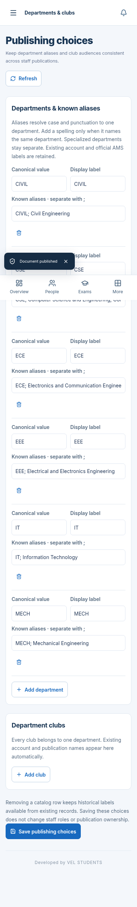
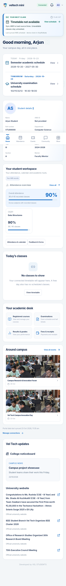
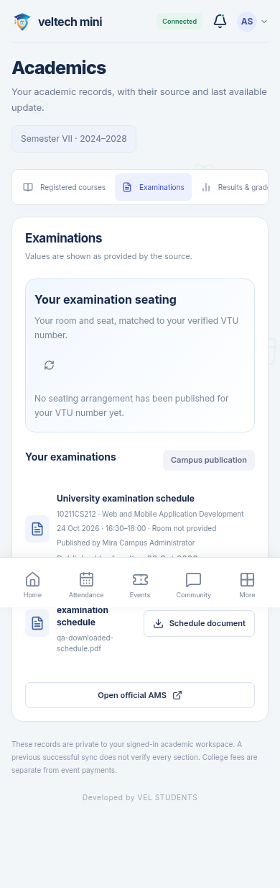
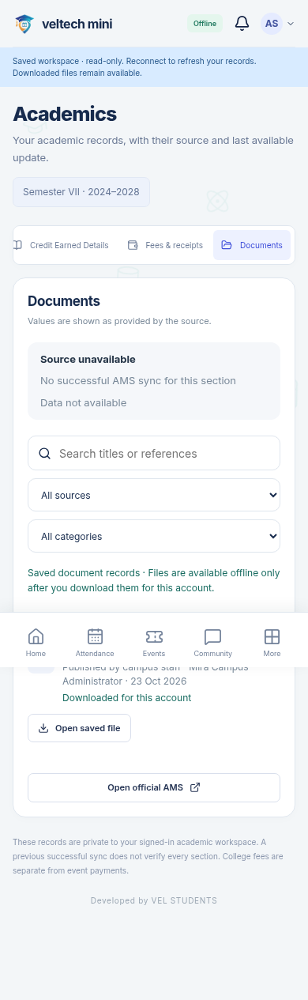

# veltech-ams-mini 2.1.0

[Full project ZIP](veltech-ams-mini-v2.1.0.zip) · [Windows Docker setup](setup-guide.md) · [Upgrade guide](upgrade-guide.md) · [SMTP guide](smtp-guide.md) · [Recorded preview](preview.mp4) · [Verification](verification.md)

This is a visual preview using controlled fictional accounts. Run the source with Docker for the connected app. The built [web/PWA package](veltech-ams-mini-web.zip) needs the backend for connected accounts; it is not a signed APK.

## Event creator

Five working creation steps, campus/online/hybrid format, structured agenda, registration rules, contacts, accessibility and participant instructions. Meeting links are restricted to managers and confirmed participants.

## Numbered examination imports

Rows remain numbered across pagination. Duplicate overlapping course sessions are rejected for the same audience. Exact student matching uses protected AMS registrations.

## Campus documents and audience choices

Staff can publish restricted academic documents alongside supported AMS files. Known department and club choices prevent accidental audience mismatches.

## Student view and offline access

The existing Home layout is retained. New exam announcements appear in reminders for 24 hours, then return within 72 hours of the exam. Background updates keep academic records visible.

Saved academic records and previously downloaded files can be opened offline for the same account. Offline mode is read-only and local sign-out persists after refresh.

## Validation

874 automated checks passed. 25 real browser checks and 6 production Docker smoke checks passed, including the 35-row reference PDF, offline refresh/download/logout, exact document audience and event publication. The configuration checks cover local/production Compose, private database ports and preservation of existing private keys.

This release did not perform a fresh live AMS login, a new PostgreSQL load test or physical APK testing. Availability of upstream university pages and hosted SMTP depends on your deployment. Follow the included guide to add your HTTPS address and Android signing identity later.

Developed by VEL STUDENTS.
