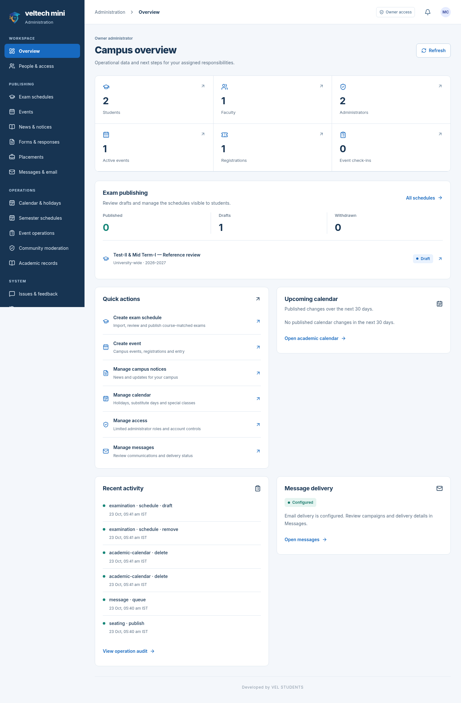
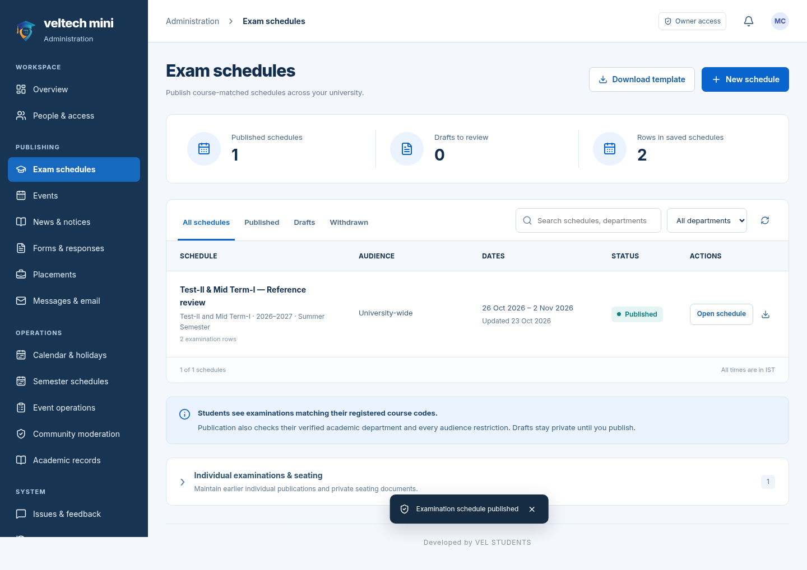
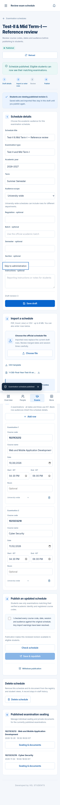
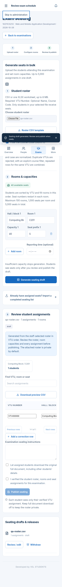
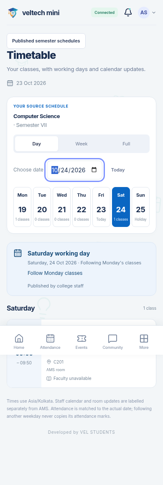

# veltech-ams-mini · administration update

Version **2.0.0**, updated without changing the project version.

[Download full project ZIP](veltech-ams-mini-v2.0.0.zip) · [Setup guide](setup-guide.md) · [Publishing and bulk seating](university-guide.md) · [SMTP configuration](smtp-guide.md) · [Recorded walkthrough](preview.mp4) · [Verification](verification.md)

These are real rendered app screenshots using controlled fictional accounts. This page is a visual preview; run the full source with Docker for the connected application. The separate web ZIP is the built PWA/static preview, not an APK.

## Admin overview

## Examination schedules

## Mobile publication editor

## Bulk seating

## Student reminders and timetable

## What was checked

810 automated tests passed. Your supplied schedule imported 35 rows with correct merged dates and times. Native service browser checks covered exact student matching, protected original download, roster allocation, calendar updates, draft corrections, republishing and removal. The guide explains one AMS refresh for older accounts and the deployment/device limits.

Developed by VEL STUDENTS.
