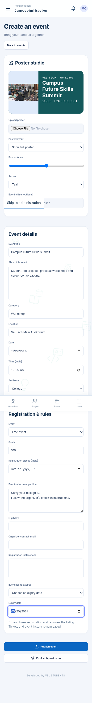
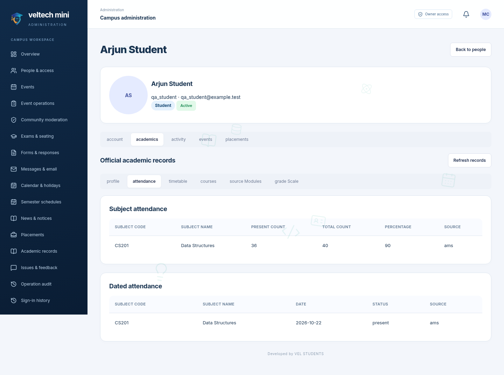
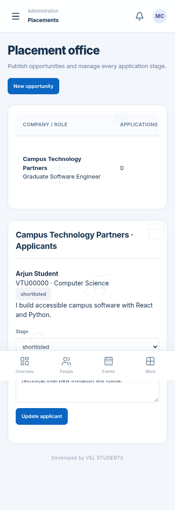
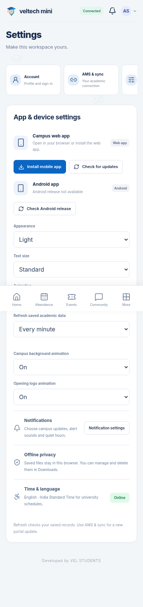

# veltech-ams-mini · 2.0.0 preview

These screenshots use fictional accounts. Connected workflows were checked with PostgreSQL-backed campus and academic services.

[Download the full project](veltech-ams-mini-v2.0.0.zip) · [Setup and upgrade guide](upgrade-guide.md) · [Recorded walkthrough](preview.mp4) · [Verification](verification.md)

## Student home

## Dedicated event publisher

## Authorized student academic records

## Placement applications and review

## Device and app settings

