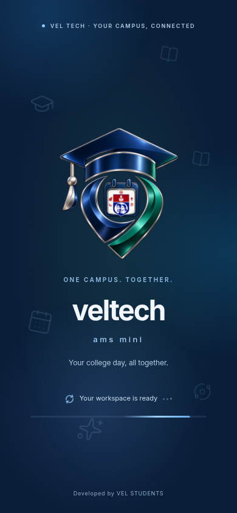
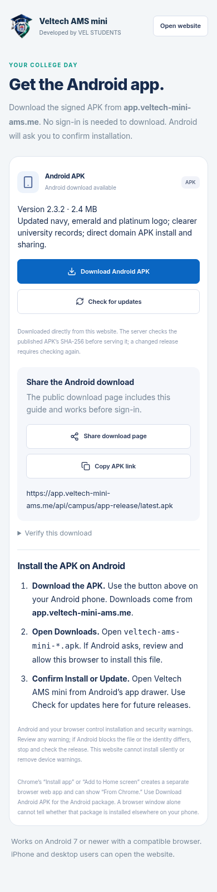
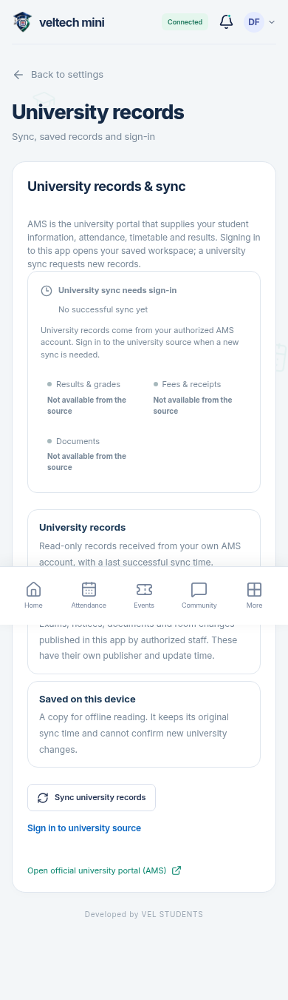
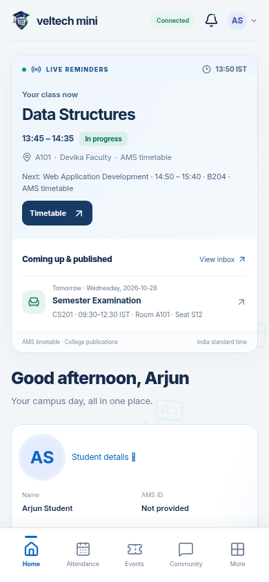
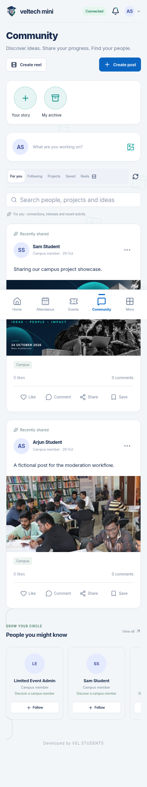
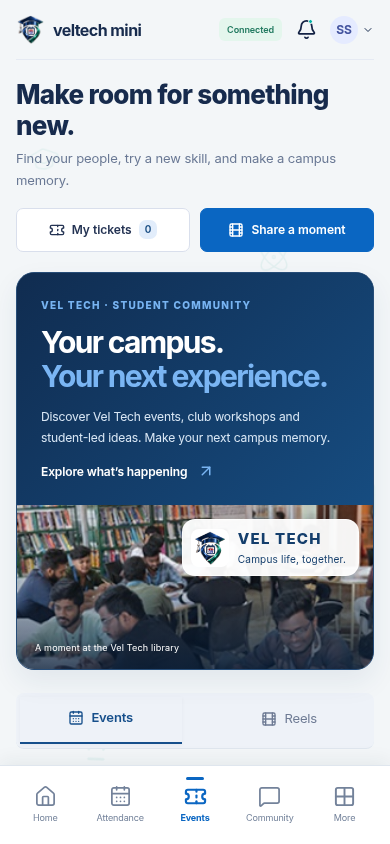

# veltech-ams-mini 2.3.2

[Full updated project ZIP](veltech-ams-mini-v2.3.2.zip) · [Setup, install and share guide](setup-guide.md) · [Watch animation and installation preview](preview.mp4) · [Verification](verification.md)

Same hybrid logo design, recoloured navy, emerald and platinum. The centre university emblem has its own animation. Web/login/settings/PWA and the signed Android launcher/splash use the updated artwork. University records, staff updates and offline device copies are clearly distinguished.

The full owner ZIP includes the complete combined source and public Android deployment files. Student APK delivery is from your domain after deployment:

- Share page: **https://app.veltech-mini-ams.me/#/install**
- Direct APK: **https://app.veltech-mini-ams.me/api/campus/app-release/latest.apk**

The current live domain reported no available APK and a different signing certificate on28October2026. Follow the guide to publish the release, preserve the correct original signing key for installed APK updates, and deploy matching Asset Links. No AWS production changes were made here. A website deployment alone does not replace an installed APK.

Returning verified students retain password-only app login. A new university source session can still require official verification. Android/browser reputation and installation prompts cannot be removed by the website.

Fresh checks: **976 automated tests and34 browser checks passed**, production PWA build and genuine signed APK compile/signature/identity/alignment/hash checks. An independent code review found no material regression. Browser examples use fictional preverified users. Fresh authenticated AMS data, physical phone installation/update, production deployment and campus-scale load testing were not performed.

Developed by VEL STUDENTS.
